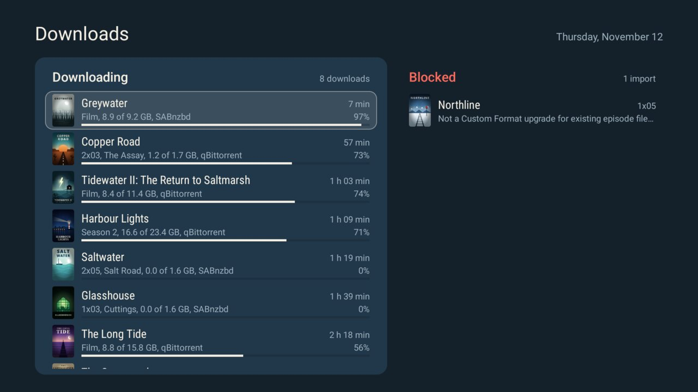

# Releases

What your Sonarr and Radarr release today, what comes in the next 7 days, and what was added last, as one screen
on the TV. For the [Clean Your TV](../../README.md) launcher it declares a [module card](../../docs/modules.md)
("Releases"). On any other Android TV home it is an ordinary app.

| Column | Shows |
|---|---|
| Recently added | The last imports, newest first, one card per import: a film, an episode ("3x05") or a season pack ("Season 1"). |
| Today | The films, then the episodes by air time, each with its poster and "Downloaded", "Downloading", "Blocked", "Missing", "Not aired yet" or "Not monitored". Today is the lit panel in the middle. |
| Coming up | The next 7 days as an agenda. Days without a release are left out. |



A title or a detail that does not fit in its row scrolls while that row has the focus.

At the foot of Today is the Downloads link, with how many downloads are in the queue and how many imports are
blocked. OK on it opens Downloads: every download with its progress, size, time left and client, soonest first, and
each blocked import with the reason that Sonarr or Radarr gives. A season pack is one download.
Back returns. The queue is read again once a minute while the screen shows: the servers ask their download clients
about that often.

- "Today" is the day on the TV's clock. An episode counts by its air time in the TV's time zone.
- A film counts when one of its release dates is on that day.
- A server that does not answer shows as an error line, never as an empty column.

## Set it up

Copy `servers.example.json` to `servers.json` (git-ignored: it holds API keys) and edit it.

| Key | Meaning |
|---|---|
| `url` | The address of the server, with its URL base if it has one. |
| `key` | The API key, from Settings > General in Sonarr or Radarr. |
| `unmonitored` | `true` also lists the titles that are not monitored. |
| `types` | Radarr only. The release dates that count: `digitalRelease`, `physicalRelease`, `inCinemas`, separated by commas. Leave it out for all three. |

Leave out `sonarr` or `radarr` if you have only one of them.

## Build and install

JDK 17 and Android SDK platform 34 with build-tools 34.0.0, as for the launcher, or `tools/docker-build.sh addons/releases`:

```bash
cd addons/releases && ./gradlew assembleRelease && cd ../..
TV_HOST=<tv ip> tools/venv/bin/python -I tools/tv.py --push addons/releases/app/build/outputs/apk/release/app-release.apk /data/local/tmp/addon.apk
TV_HOST=<tv ip> tools/venv/bin/python -I tools/tv.py 'pm install -r /data/local/tmp/addon.apk; rm -f /data/local/tmp/addon.apk'
TV_HOST=<tv ip> addons/releases/setup.sh
```

Press Home: the launcher asks once whether to show the card.

## Playing a title

OK on a title does nothing: Releases shows what there is, and you play it in your own player. A link to a player
was tried and left out. The findings, for whoever wants to add one:

| Player | Result |
|---|---|
| [Plezy](https://github.com/edde746/plezy) 2.25.0 | Tested, works: `plezy://play?type=movie&tmdb=<id>` and `type=show&tvdb=<id>` play a title by the ids that Radarr and Sonarr give. Left out because few people use Plezy. |
| Plex for Android TV 2026.22.0 | Tested, does not work: the app accepts a `plex://` link, comes to the front and stays on its home screen. Tried `plex://server://<server id>/com.plexapp.plugins.library/library/metadata/<item>`, `plex://play/` and `plex://preplay/` with `metadataKey` and `server`, with and without the `START_PLAYBACK` extra. A link would also need a Plex token, to find the item by its TMDB or TVDB id. |
| Jellyfin for Android TV 0.20.0 | Not tested, no server at hand. The app declares no link for a title, only its start and a search. |
| Emby for Android TV 2.5.05g | Not tested, no server at hand. The app declares `embyatv://tv.emby.embyatv/play` and `/displayitem` links; how they name an item is not declared. |

## Permissions

| Permission | Why |
|---|---|
| `INTERNET` | Only to read the Sonarr and Radarr in `servers.json`. Nothing else goes online. |

No account, no telemetry, no ads, no background service. Each time its screen opens, the app asks each server
for the calendar, the import history and the queue (6 requests), and for the poster of each title it has not
seen before. While the screen shows, it asks for the queue again once a minute (2 requests), and it stops when the
screen goes away. Posters come from the servers' own picture store and stay in the app's cache folder. The API keys
stay in the app's own storage, which is not backed up. The door that `setup.sh` uses needs
`WRITE_SECURE_SETTINGS`, which only the ADB shell has.

## Tested on

Sony XR-55X90J (BRAVIA_VH2_EU), Google TV 12.
